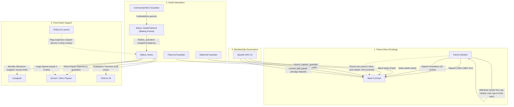

# Ward

**A children's trust on NEAR that no single relative can empty — protecting orphans from property grabbing.**

> Status: **in progress** (NEAR Hackathon 2026, track: **Social Money**). Live plan and progress: [`ROADMAP.md`](ROADMAP.md).

---

## 1. Problem & Context

When a parent dies in much of sub-Saharan Africa, relatives frequently seize money and property meant for the surviving spouse and children—a practice known as **property grabbing**:
- **Uganda:** ~30% of widows report property grabbing; in Mukono District, 548 of 1,806 widows surveyed were victims.
- **Namibia:** 44% of widows and orphans lost cattle; 39% lost agricultural equipment.
- **Zambia:** A single legal aid clinic handles 700+ property-grabbing cases annually with only 8 lawyers nationwide.
- **Judicial barriers:** Courts are slow, expensive, and suing in-laws carries prohibitive social costs for vulnerable families.

Existing crypto inheritance tools solve *"how do my heirs get my keys"*. None solve **"how do I protect my children from the guardians appointed to care for them."**

Ward enforces social money rules on-chain so that post-death support flows under checks and balances no single relative or clan circle can override.

---

## 2. How It Works



### Core Architecture Rules
1. **Circle Diversity:** Guardians must span at least 2 distinct circles (`Maternal`, `Paternal`, `Community`, `Institution`) with at most 2 guardians per circle. Any 3 approvals inherently span multiple circles.
2. **Direct-to-Payee:** School and medical expenses are paid directly to verified payee accounts, never through the caregiver's personal wallet.
3. **Child Rights:** At age 14, children can flag requests, forcing 2-circle guardian consensus. At age 18, children unlock their share through graduation tranches.
4. **DAO Separation:** Sputnik DAO handles guardian replacement, caregiver appointment, and payee addition. The DAO never moves money.

### Web Application (`apps/web`)
- **Landing Page (`/`):** Explains the property-grabbing problem, 4-step protection flow, and demo links.
- **Trust Creation Wizard (`/create`):** Multi-step wizard with live validation from `@ward/core`:
  - Validates child shares sum to exactly 10,000 bps (100%) via `rules.validateShares`.
  - Validates 3–5 guardians across $\ge 2$ distinct circles with $\le 2$ per circle via `GuardianPicker` and `rules.validateGuardians`.
  - Integrates NEAR wallet connection (MyNearWallet, Meteor, HOT) via `setupWallet`.
- **Public Trust Ledger (`/t/[id]`):** Transparent on-chain explorer for any trust:
  - Live status, token balance, and `DemoModeBanner` if accelerated.
  - Plain-language rules summary via `RulesSummary` (allowance, large spend threshold, death quorum, grace period).
  - Guardians grouped by circle with `CircleBadge` and child share allocations.
  - Activity timeline via `Timeline` tracking on-chain events and governance requests.
- **Fund Deposit Portal (`/t/[id]/fund`):** Trust funding interface:
  - Direct NEP-141 token deposits using `calls.deposit` and `ft_transfer_call`.
  - Amount presets and raw unit parsing via `parseAmount`.
  - Any-chain cross-chain quote slot for multichain funding simulations via NEAR Chain Signatures.
- **Guardian Governance Inbox (`/t/[id]/guardian`):** Multi-circle governance hub for council members:
  - Submit and verify death attestations with certified hash proof (`calls.attestDeath`).
  - Review and vote on disbursement requests with `RequestCard` and live `ApprovalProgress`.
  - Veto pending over-cap settlor withdrawals (`calls.vetoWithdrawal`).
  - Invoke emergency pauses (`calls.pause`).
- **Caregiver Portal (`/t/[id]/caregiver`):** Operations hub for designated caregivers:
  - Claim scheduled maintenance living allowance with live claimable amount preview (`calls.claimAllowance`).
  - Submit extraordinary disbursement requests (`PayeePayment`, `LargeSpend`, `SetChildAccount`) using `calls.createRequest`.
  - In-browser SHA-256 document hashing for uploading tuition invoices and hospital receipts (`receipt_hash`).
  - Track open and past requests with real-time guardian consensus progress.
- **Child Beneficiary Portal (`/t/[id]/child`):** Rights and distribution portal for beneficiaries:
  - Exercise emergency flag veto on suspicious or unverified expense requests (available at age $\ge 14$, `calls.flag`), enforcing 2-circle multi-guardian consensus.
  - Claim adult graduation tranche payouts (available at age $\ge 18$, `calls.claimGraduation`) across annual disbursement milestones.
  - Multi-sibling profile switcher to inspect individual beneficiary share allocations and rights status.
- **Accessibility & Mobile UX:**
  - Audited down to 360px viewport widths with responsive single-column collapses.
  - WCAG touch target compliance ($\ge 44\text{px}$ tap targets for interactive elements).
  - Screen reader accessible with semantic headings, skip-to-content links, ARIA tablists, and live status banners.

---

## 3. Quickstart — do X, see Y

### Prerequisites
- Node.js $\ge 22$, pnpm $\ge 9$
- Rust stable with `wasm32-unknown-unknown` target
- `cargo-near` CLI installed

### Setup & Verification
```bash
# 1. Install dependencies
pnpm install

# 2. Build smart contracts
pnpm build:contract

# 3. Run all tests (Rust unit tests, sandbox integration tests, and @ward/core tests)
pnpm test

# Or run TypeScript core tests directly
pnpm --filter @ward/core test

# Or run web component Vitest suite (12 test suites, 48 tests)
pnpm --filter @ward/web test

# Or run individual sandbox test suites
cargo test -p ward --test circles
cargo test -p ward --test settlor_withdrawals
cargo test -p ward --test death_flow
cargo test -p ward --test allowance
cargo test -p ward --test requests
cargo test -p ward --test children
cargo test -p ward --test council
cargo test -p ward --test transfer_failures

# 4. Run workspace linter and type-checker
pnpm lint

# 5. Verify testnet deployment (idempotent)
pnpm --filter @ward/scripts exec tsx deploy-testnet.ts

# 6. Run web app locally or run web component tests
pnpm --filter @ward/web dev
pnpm --filter @ward/web test
pnpm --filter @ward/web build
```

---

## 4. Limitations & Non-Goals

- **Money Only:** Ward protects digital funds (stablecoins/NEAR). It does not protect physical real estate, land titles, houses, or livestock.
- **Legal Jurisdiction:** Ward operates as autonomous on-chain code; it is not a court-registered legal will or formal trust under civil law.
- **No Direct Fiat Off-ramp:** In the demo and on testnet, transactions use NEP-141 tokens. Integration with local mobile money agents is out of current hackathon scope.
- **Identity & Registries:** Death confirmation is social (3 distinct guardian attestations) rather than linked to government civil registries.

---

## 5. Libraries and AI Disclosure

- **Smart Contract Framework:** `near-sdk` 5.30.0 with `near-contract-standards` (NEP-141 / NEP-145 / NEP-297).
- **Integration Test Harness:** `near-workspaces` 0.16.1 sandbox environment.
- **Governance:** Sputnik DAO v2 (`contracts/ward/res/sputnikdao2.wasm`, commit-pinned from testnet).
- **Shared TypeScript Core (`@ward/core`):** Pure rule engine (`rules.ts`) mirroring smart contract invariants for instant UI previews, Zod schemas (`types.ts`) for deserializing on-chain trust state, typed view/call helpers (`contract.ts`), and bigint-safe amount/explorer formatters (`format.ts`, `config.ts`).
- **Frontend / Fullstack:** Next.js 16.4.4, TypeScript, Tailwind CSS, Vitest.
- **AI Tooling Disclosure:** Code scaffolding, test authoring, and documentation refinement assisted by DeepMind Antigravity AI pair programming.
- **Other Entered Project:** The team is also submitting **Sealed Tip** (whistleblower bounties and private verification) in the *Privacy & Private AI* track.

---

## 6. Contributing

- Read `AGENTS.md` before submitting contributions.
- All tasks are tracked in GitHub issues (index: [`docs/ISSUES.md`](docs/ISSUES.md)).
- **ROADMAP.md Rule:** Every contribution must update [`ROADMAP.md`](ROADMAP.md) (task status and Changelog) in the same commit/PR.
- Maintain architecture documentation alignment (`ARCHITECTURE.md`, `ARCHITECTURE_ESSENTIALS.md`, `project_structure.md`).

---

## 7. License

MIT — see [`LICENSE`](LICENSE).
